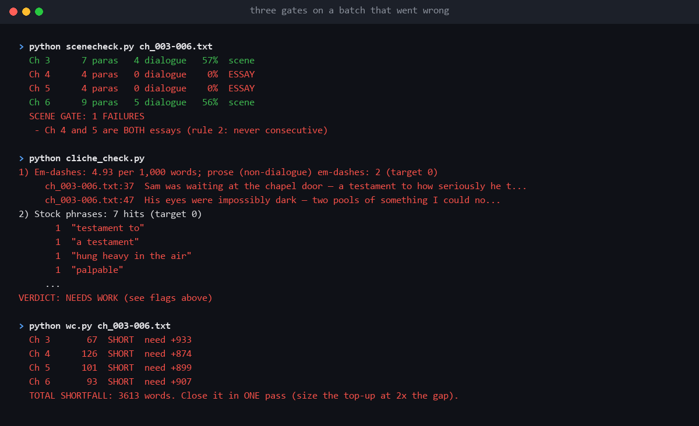

# Serial Novel Engine


**A Claude skill for writing long serial fiction without it falling apart at chapter 150.**
Plan the whole book before Chapter 1, draft in small batches, and let scripts check every batch for the
failures a human stops noticing: chapters that drift out of length, scenes that quietly turn into summary,
and the habits readers skim.

Built while finishing a run of 200-360 chapter web serials. Every rule here exists because something broke.



---

## Try it in 30 seconds

No install, no dependencies, just Python 3.8+.

```bash
git clone https://github.com/chapterforge/serial-novel-engine
cd serial-novel-engine/skills/serial-novel-engine/scripts
python scenecheck.py --dir ../../../examples/broken ch_003-006.txt
python cliche_check.py --dir ../../../examples/broken
python wc.py --dir ../../../examples/broken ch_003-006.txt
```

`examples/broken/` is a batch with real problems in it, and each gate catches its share (the screenshot
above). On Windows, use `py` if `python` opens the Microsoft Store.

Then install the skill and ask Claude: *"Use the serial novel engine. Help me plan a 200-chapter
enemies-to-lovers serial."*

## What the gates catch

| Gate | Fails when | Why it matters |
|---|---|---|
| `wc.py` | a chapter is outside the word band (default 1,000-1,150; Ch 1 1,800-2,200) | prints the exact gap, so one revision closes it instead of five |
| `scenecheck.py` | a chapter has under 20% dialogue paragraphs (an "essay") twice in a row, or more than one in four | the first-person narrator drifts into summary, and readers feel it as "nothing happens". One 300-chapter book let this run for 110 chapters before anyone counted |
| `cliche_check.py` | narration em-dashes, stock phrases (*a testament to*, *palpable*, *pools of*), aphorism scaffolding (*The truth is*) | the phrases readers skim; cutting them is retention work. `--fix` removes spaced em-dashes |

Every gate exits **0 on pass, 1 on fail**, so you can chain them, script them, or run them in CI.

## How it works

A skill is a folder of instructions plus scripts. Claude reads `SKILL.md`, follows the three-stage method,
and runs the scripts itself after each batch.

```
skills/serial-novel-engine/
  SKILL.md                    the method: plan -> write -> gate, and how to run a session
  references/
    craft-laws.md             19 laws, each from a book that broke without it
    manuscript-format.md      ===CHAPTER N=== blocks, one file per batch
  scripts/
    wc.py  scenecheck.py  cliche_check.py      standard library only, --dir points at any manuscript
examples/
  manuscript/                 a clean batch (passes, except the deliberately short word count)
  broken/                     a batch with problems each gate catches
tests/test_gates.py           proves every gate passes good input and fails bad input
```

**The method in three stages:**
1. **Before a word is written:** the whole book planned, one row per chapter, every row with a date, a beat,
   the cliffhanger it ends on and the reader question it opens. Re-read the chapters the batch depends on.
2. **Writing:** two scenes a chapter; plant a question in the first half; end on a turn, never on reflection.
3. **After:** run the gates. A batch isn't done until they pass.

## Use it in CI

If your manuscript lives in git, the gates work as checks on every push:

```yaml
# .github/workflows/manuscript.yml
name: manuscript
on: [push, pull_request]
jobs:
  gates:
    runs-on: ubuntu-latest
    steps:
      - uses: actions/checkout@v4
      - uses: actions/setup-python@v5
        with: { python-version: "3.12" }
      - run: git clone --depth 1 https://github.com/chapterforge/serial-novel-engine /tmp/sne
      - run: python /tmp/sne/skills/serial-novel-engine/scripts/scenecheck.py --dir manuscript
      - run: python /tmp/sne/skills/serial-novel-engine/scripts/cliche_check.py --dir manuscript
```

## Prove every gate can fail

```bash
python tests/test_gates.py
```

A check that has never been seen failing can't be trusted. In a real pipeline, two checks once ran for two
whole books without ever firing: the regex `\b` had been written through a shell heredoc and turned into a
literal backspace byte, so they searched for a character that never occurs. Everything looked green. The
tests run each gate on a batch that must pass and one that must fail, scan the scripts for that byte, and run
in CI on Linux, macOS and Windows (the badge at the top).

## Install

**Claude Code (plugin):**
```
/plugin marketplace add chapterforge/serial-novel-engine
/plugin install serial-novel-engine@serial-novel-engine
```

**Claude Code (manual):** copy `skills/serial-novel-engine/` into `~/.claude/skills/` (or `.claude/skills/` in
your project).

**Claude.ai:** download `serial-novel-engine.zip` from the [latest release](../../releases), then upload it in
Settings → Capabilities → Skills.

## Pro edition

The free edition covers the drafting loop. **Pro** keeps a 200+ chapter book consistent across the whole book:

| | Free | Pro |
|---|:---:|:---:|
| Three-stage method, word band, scene gate, cliché check | ✓ | ✓ |
| **Blueprint gate:** every chapter planned, typed cliffs, two engines, scene plans | | ✓ |
| **The debt rule:** at most 10 open reader questions, none silent for 5+ chapters | | ✓ |
| **Plan reconciliation:** did the chapter end on the cliff its row planned? | | ✓ |
| **Continuity:** fixed facts, drifting ages, banned claims, lonely names | | ✓ |
| **Whole-book audits:** calendar, duplicate titles, threads, pacing drag | | ✓ |
| Batch gate (all checks in one command), new-book setup, .docx export | | ✓ |
| 59-law rulebook, 10-chapter sample book, 59-check test suite, step-by-step guide | | ✓ |

→ **[Get Pro ($29)](https://chapterforgestudio.gumroad.com/l/paagmk)**: Claude Code plugin and Claude.ai
skills, free updates for v1.x, 14-day refund.

## Contributing

Issues and pull requests are welcome: a false positive in a gate, a stock phrase that should be on the list, a
platform quirk. Run `python tests/test_gates.py` before opening a PR; a new check needs a case that passes and a
case that fails.

If it saves your book at chapter 150, a star helps other writers find it.

## License

MIT. See [LICENSE](LICENSE).
